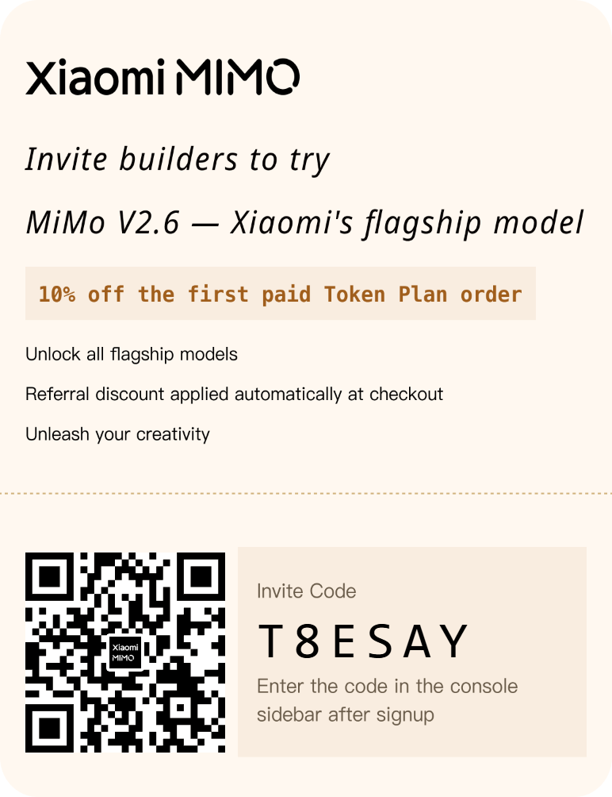

Many thanks to those who subscribe via my referral links! 🙏

## Claude Ecosystem

### [AgentKit](https://agentkit.best/?ref=BWA910UK)

AgentKit — formerly **ClaudeKit** (`claudekit.cc`) — packages production-ready skills, slash commands, subagents, and workflows for coding agents such as Claude Code, Codex, and GitHub Copilot, so sessions stay consistent instead of restarting from scratch every time.

- **AgentKit Engineer** ($99, one-time) — 100+ skills and 30+ workflows plus engineer subagents covering frontend, backend, databases, DevOps, code review, and debugging.
- **AgentKit Marketing** ($99, one-time) — 12+ MCP integrations and marketing subagents for lead research, programmatic SEO, content, and CRM outreach.
- **Bundle** ($149) — both kits plus a 1-year AgentKit App license for 3 devices. Combined, the kits ship 95+ commands and 45 subagents.
- **AgentKit App** ($49/year for 1 device, $99/year for 3) — a desktop control center for the `ak` CLI with kit management, a visual skill graph, and a status line builder.

All purchases include a 14-day refund guarantee.

Sign up via the referral link to get **20% off** your first purchase!

Referral code: `BWA910UK`

Link: https://agentkit.best/?ref=BWA910UK

## AI Coding Platforms & LLM APIs

### [OrcaRouter](https://www.orcarouter.ai/ref/ref_3976ba42abf37dc55c1d)

OrcaRouter lets you access 200+ AI models through one OpenAI-compatible API with automatic routing and failover.

Sign up through my referral link: https://www.orcarouter.ai/ref/ref_3976ba42abf37dc55c1d

Referral code: `ref_3976ba42abf37dc55c1d`

**TL;DR — current offers checked Nov 20, 2026 (UTC+7):**

- **Always-free models:** DeepSeek V4.1 Flash, DeepSeek V4 Flash, GLM-5.3-Flash, Tencent Hy4 Preview, Tencent Hy3, plus the `orcarouter/free` router. They need a linked GitHub account with some history, or any paid purchase.
- **DeepSeek V4.1 Flash:** Get a 100% deposit match, with no cap listed, on top-ups of $20 or more when you enroll by **Dec 18**. Match credit expires Jan 17, 2027.
- **Fable 5.2:** Get a 100% deposit match, up to about $200, on top-ups of $10 or more when you enroll by **Dec 11**. Match credit expires Jan 10, 2027.

Offers can change quickly, so check the [live offers page](https://www.orcarouter.ai/offers) before claiming.

### [Z.ai](https://z.ai/subscribe?ic=PLKIAYEIPW)

🚀 You've been invited to join the GLM Coding Plan! Enjoy full support for Claude Code, Cline, and 20+ top coding tools — starting at just $18/month. Subscribe now and grab the limited-time deal! Link： https://z.ai/subscribe?ic=PLKIAYEIPW

### [Kimi](https://kimi-bot.com/activities/viral-referral/share?scenario=invite&from=share_poster&invitation_code=C8CJ6F)

Boost me and we both win! Sign up or subscribe to Kimi (Moonshot AI) and we each get a guaranteed membership-credit prize, ranging from 3 days up to **1 year**. Credits expire at the end of their duration or on Dec 31, 2026, whichever comes first.

- **Sign up:** https://kimi-bot.com/activities/viral-referral/share?scenario=invite&from=share_poster&invitation_code=C8CJ6F
- **Subscribe:** https://kimi-bot.com/activities/viral-referral/share?scenario=subscribe&from=share_poster&invitation_code=C8CJ6F

Invitation code: `C8CJ6F`

### [Synthetic](https://synthetic.new/?referral=CNBFyw28zF0dZoj)

Thanks for helping us grow!

Invite your friends to Synthetic and when they subscribe, both of you will receive **$10.00** in subscription credit if they choose the Standard plan or higher, or **$3.00** if they choose the Go plan. This discount won't stack with other offers.

Share Your Referral Link

https://synthetic.new/?referral=CNBFyw28zF0dZoj

Your referral link contains your unique code: CNBFyw28zF0dZoj

### [Hermes Agent Cloud](https://portal.nousresearch.com/r/tien-nguyen-minh)

Hermes Agent Cloud is the hosted subscription for Nous Research's Hermes Agent. Subscribe through my link to get **$15 off** your first paid month.

The discount applies only to new customers starting a new personal subscription, and only with a payment card that hasn't been used for another referral.

Link: https://portal.nousresearch.com/r/tien-nguyen-minh

### [Xiaomi MiMo](https://platform.xiaomimimo.com?ref=T8ESAY)

Invite builders to try MiMo V2.6, Xiaomi's flagship model.

- **Friend:** signs up and gets **10% off** their first paid Token Plan order, applied automatically at checkout.
- **Me:** earns 10% back in credits on that order, valid for 40 days.

Auto-bind via the link, or enter the code in the console sidebar after signup.

Invite code: `T8ESAY`

Link: https://platform.xiaomimimo.com?ref=T8ESAY

### [LLM Gateway](https://llmgateway.io/?ref=jdsmz02j3nmaB9BqziZt)

LLM Gateway is an open-source gateway that routes requests to many LLM providers through one OpenAI- and Anthropic-compatible API. Bring your own keys for free, pay as you go, or pick a **DevPass** plan for coding agents (Lite $29, Pro $79, Max $179 a month), each including twice its price in model usage.

Sign up through my referral link: https://llmgateway.io/?ref=jdsmz02j3nmaB9BqziZt

### [Alibaba Cloud](https://www.alibabacloud.com/campaign/benefits?referral_code=A92LU5)

Alibaba Cloud Model Studio gives one-stop access to the full Qwen series and leading third-party LLMs through OpenAI-compatible APIs, with multimodal support. Its **Token Plan** bundles Qwen and third-party models such as DeepSeek and GLM for coding tools in one monthly subscription.

Sign up via the referral link as a new user to try Model Studio and Token Plan.

Referral code: `A92LU5`

Link: https://www.alibabacloud.com/campaign/benefits?referral_code=A92LU5

## Managed Data Platforms

### [Aiven](https://console.aiven.io/signup?referral_code=dgxaaojd772ygmk7bjr6)

Aiven is a managed open-source data platform (Database-as-a-Service) — fully hosted databases, streaming, and analytics services deployable across all major clouds. Offerings include PostgreSQL, MySQL, Apache Kafka, ClickHouse, OpenSearch, Valkey, and more, managed from a single console. It is not a VPS or compute provider — you consume ready-to-use data services, not virtual machines.

Sign up via my referral link and start the Aiven trial to get an extra **$100.00 USD** in credits to spend.

Referral code: `dgxaaojd772ygmk7bjr6`

Link: https://console.aiven.io/signup?referral_code=dgxaaojd772ygmk7bjr6

## Cloud Storage

### [PikPak](https://mypikpak.com/drive/activity/invited?invitation-code=75940186)

PikPak is a private cloud storage service with built-in support for magnet links, torrents, and saving videos from the web — great for offline downloads and cross-device access.

Sign up with my invitation code to unlock **5 free premium days** with 10 TB of premium storage — no payment card required. Enter the code within 12 hours of registration, or install directly via the link to auto-bind the invitation.

Invitation code: `75940186`

Link: https://mypikpak.com/drive/activity/invited?invitation-code=75940186
