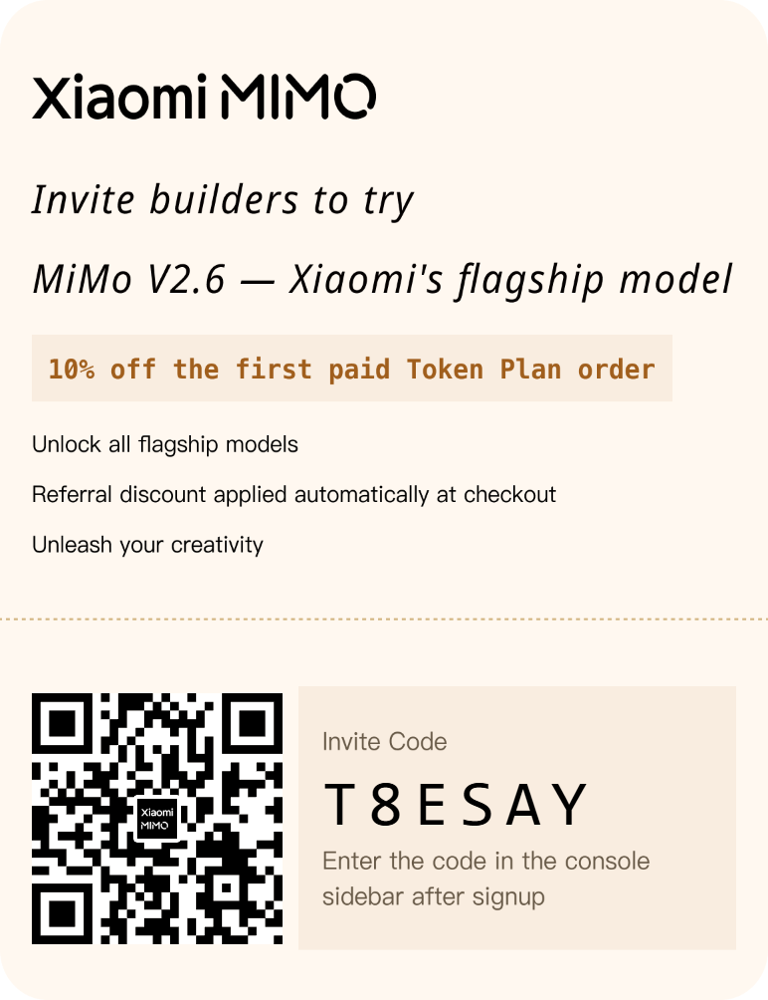

Mình có thể nhận tín dụng hoặc hoa hồng nếu bạn đăng ký hay mua dịch vụ qua các liên kết này. Bạn nên kiểm tra ưu đãi và điều kiện áp dụng trên trang của nhà cung cấp trước khi thanh toán. Cảm ơn bạn đã ủng hộ blog!

## Công cụ cho trợ lý lập trình {#claude-ecosystem}

### [Claude Code Guest Pass](https://claude.ai/referral/ZkoAngod1A)

Thẻ khách tặng bạn bè một tuần dùng thử Claude Code miễn phí. Nếu bạn đăng ký gói trả phí sau đó, mình nhận thêm hạn mức sử dụng.

Liên kết: https://claude.ai/referral/ZkoAngod1A

### [AgentKit](https://agentkit.best/?ref=BWA910UK)

AgentKit, trước đây là ClaudeKit, cung cấp kỹ năng, lệnh và quy trình làm việc cho các trợ lý lập trình như Claude Code, Codex và GitHub Copilot.

Liên kết giới thiệu giảm **20%** cho lần mua đầu tiên. Mã giới thiệu: `BWA910UK`.

## Gói AI cho lập trình và API mô hình {#ai-coding-platforms--llm-apis}

### [OrcaRouter](https://www.orcarouter.ai/ref/ref_3976ba42abf37dc55c1d)

OrcaRouter cho phép gọi nhiều mô hình qua một API tương thích với OpenAI, hỗ trợ tự động định tuyến và chuyển sang nhà cung cấp dự phòng. Xem [ưu đãi hiện hành](https://www.orcarouter.ai/offers) để biết mô hình miễn phí, tín dụng và điều kiện áp dụng.

Mã giới thiệu: `ref_3976ba42abf37dc55c1d`.

### [Z.ai](https://z.ai/subscribe?ic=PLKIAYEIPW)

GLM Coding Plan dùng được với các công cụ như Claude Code và Cline. Mở liên kết mời để xem các gói và giá hiện hành.

### [Synthetic](https://synthetic.new/?referral=CNBFyw28zF0dZoj)

Khi bạn mua gói qua liên kết giới thiệu, mỗi người nhận **10 USD** tín dụng với gói Standard trở lên hoặc **3 USD** với gói Go. Ưu đãi này không cộng dồn với ưu đãi khác.

Mã giới thiệu: `CNBFyw28zF0dZoj`.

### [Hermes Agent Cloud](https://portal.nousresearch.com/r/tien-nguyen-minh)

Đây là dịch vụ chạy Hermes Agent trên đám mây của Nous Research. Liên kết giới thiệu giảm **15 USD** cho tháng trả phí đầu tiên khi bạn đăng ký gói cá nhân lần đầu bằng thẻ chưa từng dùng cho lượt giới thiệu khác.

### [Xiaomi MiMo](https://platform.xiaomimimo.com?ref=T8ESAY)

Bạn được giảm **10%** cho lần mua Token Plan đầu tiên. Mình nhận lại 10% dưới dạng tín dụng có hạn 40 ngày. Bạn có thể dùng liên kết mời hoặc nhập mã trong trang quản lý sau khi đăng ký.

Mã mời: `T8ESAY`.

### [LLM Gateway](https://llmgateway.io/?ref=jdsmz02j3nmaB9BqziZt)

Cổng API mã nguồn mở kết nối nhiều nhà cung cấp mô hình qua giao diện tương thích với OpenAI và Anthropic. Bạn có thể dùng khóa API của mình, trả theo mức sử dụng hoặc chọn gói DevPass.

### [NanoGPT](https://nano-gpt.com/r/KRRRwQj4)

NanoGPT cho phép dùng các mô hình AI theo mức sử dụng hoặc theo gói. Liên kết giới thiệu giảm **5%** cho lượt sử dụng đủ điều kiện.

Mã giới thiệu: `KRRRwQj4`.

### [Alibaba Cloud](https://www.alibabacloud.com/campaign/benefits?referral_code=A92LU5)

Model Studio cung cấp Qwen và các mô hình khác qua API tương thích với OpenAI. Token Plan là gói thuê bao hằng tháng dành cho các công cụ lập trình.

Mã giới thiệu: `A92LU5`.

## Tạo ứng dụng bằng AI {#ai-app-builders}

### [Lovable](https://lovable.dev/invite/F2BPEOE)

Lovable tạo ứng dụng web từ mô tả, cho phép xem trước và triển khai ngay trong công cụ. Đăng ký qua liên kết mời để nhận **10 tín dụng**.

### [Bolt.new](https://bolt.cello.so/G2EUTJII7XU)

Bolt.new cho phép tạo, chạy thử và triển khai ứng dụng từ mô tả ngay trong trình duyệt. Liên kết mời giảm **20%**.

## Hạ tầng đám mây {#cloud-computing}

### [Railway](https://railway.com?referralCode=otNjpD)

Railway triển khai ứng dụng, cơ sở dữ liệu và tác vụ định kỳ từ kho GitHub hoặc Docker image. Đăng ký qua liên kết mời để nhận **20 USD** tín dụng.

Mã giới thiệu: `otNjpD`.

### [DigitalOcean](https://m.do.co/c/2bff83fffe9a)

DigitalOcean cung cấp máy chủ ảo (Droplets), cơ sở dữ liệu được quản lý, Kubernetes và App Platform.

### [Runpod](https://runpod.io?ref=jpu0zh3f)

Runpod cho thuê GPU dưới dạng Pod hoặc điểm cuối serverless để huấn luyện và chạy mô hình AI. Nếu lần đầu dùng Runpod, hãy mở liên kết mời, đăng ký bằng Google, nhận ưu đãi và nạp ít nhất **10 USD**. Mức thưởng là **5 USD** ở châu Âu và từ **5 đến 500 USD** ở các khu vực khác. Xem [điều kiện của Runpod](https://docs.runpod.io/accounts-billing/referrals).

## Dịch vụ dữ liệu được quản lý {#managed-data-platforms}

### [Aiven](https://console.aiven.io/signup?referral_code=dgxaaojd772ygmk7bjr6)

Aiven cung cấp dịch vụ dữ liệu được quản lý như PostgreSQL, Apache Kafka và ClickHouse. Bạn có thể nhận thêm **100 USD** tín dụng khi bắt đầu dùng thử qua liên kết mời.

Mã giới thiệu: `dgxaaojd772ygmk7bjr6`.

## Lưu trữ đám mây {#cloud-storage}

### [PikPak](https://mypikpak.com/drive/activity/invited?invitation-code=75940186)

PikPak lưu tệp lên đám mây từ liên kết magnet, torrent hoặc video trên web. Lời mời tặng **năm ngày Premium với 10 TB dung lượng**. Bạn có thể dùng liên kết mời hoặc nhập mã trong vòng 12 giờ sau khi đăng ký.

Mã mời: `75940186`.
