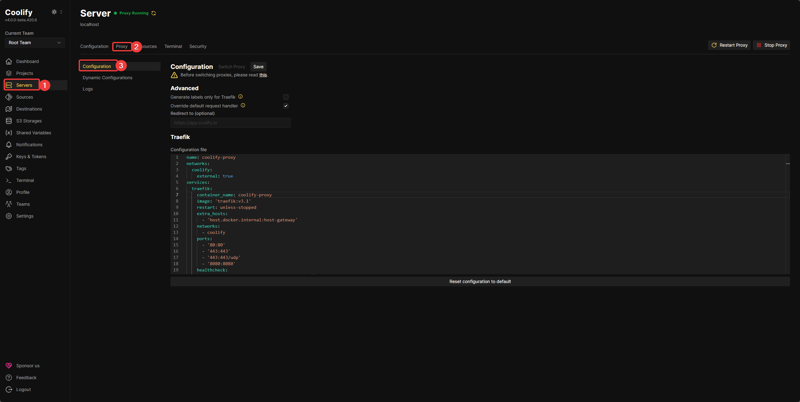

*After posting [ByteByteGo](https://bytebytego.com/) diagrams for a few days straight, let's switch things up today.*

Sometimes when you deploy GitLab or Gitea on Coolify and try to push to it, you may run into an error like this:

```
git -c diff.mnemonicprefix=false -c core.quotepath=false --no-optional-locks push -v <your-remote> <local-branch>:<remote-branch>
POST git-receive-pack (chunked)
error: RPC failed; HTTP 504 curl 22 The requested URL returned error: 504
send-pack: unexpected disconnect while reading sideband packet
fatal: the remote end hung up unexpectedly
Pushing to <your-git-url>
Everything up-to-date
Completed with errors, see above.
```

If you search around online, you'll probably come across the common suggestion to increase Git's chunk buffer like this:

``` shell
git config --global http.postBuffer <some-huge-number>
```

## Why Doesn't `git config http.postBuffer` Work?

**What is Git `http.postBuffer`?**
- It's the buffer size Git uses when sending data over HTTP POST
- By default, Git sends data in small chunks (typically 1MB)
- Increasing `postBuffer` means sending larger chunks, reducing the number of requests

**Why doesn't it help in this case?**

The issue isn't how Git sends the data — it's the **HTTP timeout on Coolify's proxy**:

1. **Git still sends the data** successfully to the Traefik proxy
2. **The Traefik proxy waits for a response** from the Git server (GitLab/Gitea)
3. **The Git server needs time to process** the data (compressing, indexing, validating, etc.)
4. **Traefik times out before** the Git server finishes responding → HTTP 504

Whether Git sends large chunks or small ones, the processing time on the Git server stays the same. That's why increasing `postBuffer` doesn't solve a timeout happening at the proxy layer.

## Architecture and Root Cause

**How a `git push` flows through the stack:**

```
Git Client → Traefik Proxy → Git Server (GitLab/Gitea)
     ↑                ↑              ↑
  postBuffer    readTimeout     Processing time
```

**Step-by-step breakdown:**

1. **Git client** sends data via HTTP POST (can take several seconds for a large repo)
2. **Traefik proxy** receives and forwards the request to the Git server
3. **Git server** starts processing:
   - Unpacking objects
   - Checking integrity
   - Updating refs
   - Running Git hooks (if any)
4. **Traefik waits for a response** up to `readTimeout` (default ~30s)
5. **If the Git server takes longer** → Traefik returns HTTP 504

**Why does this happen on Coolify?**
- Coolify uses Traefik as its reverse proxy
- Traefik's default `readTimeout` is fairly low
- Git operations with large files or repositories often take more than 30s to process
- This issue affects not just Git, but any HTTP service that needs long processing times

## Solution

Go to `Server > (your server, usually localhost) > Proxy > Configuration`.



Add the following lines under `services.traefik.command`:

``` yaml
- '--entrypoints.http.transport.respondingTimeouts.readTimeout=600s'
- '--entrypoints.https.transport.respondingTimeouts.readTimeout=600s'
```

**Explanation**:
- `readTimeout`: Maximum time Traefik waits to read a response from the backend
- `600s` (10 minutes): A reasonable timeout for large `git push` operations
- You can adjust this depending on your repository size and network speed

Full config (for reference only — this may change in future Coolify releases, so only use it to see where the lines go):

``` yaml
name: coolify-proxy
networks:
  coolify:
    external: true
services:
  traefik:
    container_name: coolify-proxy
    image: 'traefik:v3.1'
    restart: unless-stopped
    extra_hosts:
      - 'host.docker.internal:host-gateway'
    networks:
      - coolify
    ports:
      - '80:80'
      - '443:443'
      - '443:443/udp'
      - '8080:8080'
    healthcheck:
      test: 'wget -qO- http://localhost:80/ping || exit 1'
      interval: 4s
      timeout: 2s
      retries: 5
    volumes:
      - '/var/run/docker.sock:/var/run/docker.sock:ro'
      - '/data/coolify/proxy/:/traefik'
    command:
      - '--ping=true'
      - '--ping.entrypoint=http'
      - '--api.dashboard=true'
      - '--entrypoints.http.address=:80'
      - '--entrypoints.https.address=:443'
      - '--entrypoints.http.http.encodequerysemicolons=true'
      - '--entryPoints.http.http2.maxConcurrentStreams=250'
      - '--entrypoints.https.http.encodequerysemicolons=true'
      - '--entryPoints.https.http2.maxConcurrentStreams=250'
      - '--entrypoints.https.http3'
      - '--providers.file.directory=/traefik/dynamic/'
      - '--providers.file.watch=true'
      - '--certificatesresolvers.letsencrypt.acme.httpchallenge=true'
      - '--certificatesresolvers.letsencrypt.acme.httpchallenge.entrypoint=http'
      - '--certificatesresolvers.letsencrypt.acme.storage=/traefik/acme.json'
      - '--api.insecure=false'
      - '--providers.docker=true'
      - '--providers.docker.exposedbydefault=false'
      - '--entrypoints.http.transport.respondingTimeouts.readTimeout=600s'
      - '--entrypoints.https.transport.respondingTimeouts.readTimeout=600s'
    labels:
      - traefik.enable=true
      - traefik.http.routers.traefik.entrypoints=http
      - traefik.http.routers.traefik.service=api@internal
      - traefik.http.services.traefik.loadbalancer.server.port=8080
      - coolify.managed=true
      - coolify.proxy=true
```

## Applying the Changes

1. **Save**: Save the Traefik configuration
2. **Restart Proxy**: Restart the proxy to apply the new timeout
3. **Verify**: Wait for the proxy to come back online (usually takes 30–60 seconds)

## Important Notes

- **Don't set the timeout too high**: It can leave connections hanging for a long time when a real failure occurs
- **Test with a small repository first**: Make sure the configuration works as expected
- **Monitor logs**: Check the Coolify and Traefik logs for debugging if needed

Good luck, and hope you get your code pushed soon!
