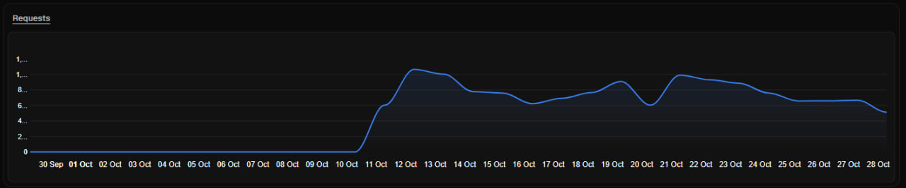
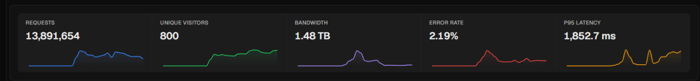
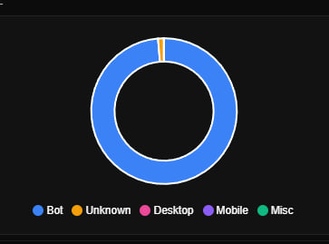
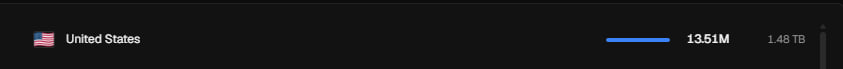
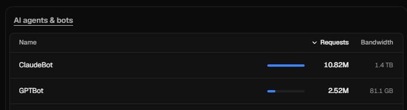
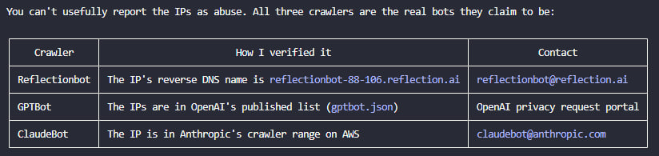

I self-host Gitea on an OCI Always Free server to keep mirrors of my GitHub repositories. I always thought of it as a quiet little corner only I ever visited — until I discovered three regular "guests" dropping by: ClaudeBot, GPTBot, and Reflectionbot. Starting from a few unusual signs in the logs, I tracked down a private repository that had unintentionally been made public, then figured out how to block the crawlers while keeping all my other apps running smoothly. Here is the full story, from discovery to mitigation and follow-up monitoring.

## Discovery

On the morning of October 29, 2026, I noticed that the server running Gitea in Japan was unusually busy. When I opened Traefik's access log, I realized the logs were rotating so fast that the retained portion only covered about 4.5 hours — from 17:55 to 22:22 UTC on October 28. In just that window, there were **86,765 requests**.

| User agent | Requests |
| --- | --- |
| ClaudeBot (Anthropic) | 39,860 |
| GPTBot (OpenAI) | 26,901 |
| Reflectionbot (Reflection AI) | 16,412 |
| Bun (my own `gitea-mirror` syncing) | 3,587 |
| Others (DuckDuckBot, OAI-SearchBot) | 5 |

Around 95% of the HTTP 200 responses came from `src`, `commit`, and `raw` pages across 86 mirrored repositories. The crawlers were walking through **every single commit of every single repo**, and each commit had multiple pages to fetch. Added together, the request volume snowballed fast.

Looking back at the full month's metrics, traffic was virtually zero until October 10. Starting October 11, it spiked and stayed consistently high:



In total, that came out to nearly **13.9 million requests** and **1.48 TB** of bandwidth — all to serve a Gitea instance meant for an audience of one:



**If you self-host on a VPS, keep a close eye on bandwidth costs.** Data downloaded by bots still counts toward your server's outbound transfer quota. Depending on your provider and plan, going over your allowance can mean surprise overage charges or throttled speeds. I got lucky because OCI's outbound bandwidth allowance is very generous, so this incident didn't cost me anything extra. On a VPS with a tighter cap, though, 1.48 TB from crawlers alone could easily turn into an unexpected bill.

Nearly all of the traffic came from bots, and almost all of it originated in the United States:





ClaudeBot alone accounted for 10.82 million requests and 1.4 TB of bandwidth. GPTBot chipped in another 2.52 million requests:



## Figuring Out the Cause

My first worry was whether my account had been compromised. Checking the logs, I found:

- Every single request was anonymous — none of them were authenticated.
- No external client sent any POST, PATCH, push, or API requests. All write operations came from the server itself via `gitea-mirror` running its sync jobs.
- All three crawlers were legitimate: GPTBot's IPs matched OpenAI's published ranges, ClaudeBot came from Anthropic's IP space, and Reflectionbot's reverse DNS resolved back to `reflection.ai`.



Nothing pointed to an account breach. The bots were simply crawling pages that Gitea left publicly accessible to anonymous visitors: they requested `/robots.txt` first, got a 404 because none existed, and proceeded to scrape every page returning HTTP 200. Looking back, I had left the front door wide open without realizing it; the primary issue to fix was my own configuration.

While auditing further, I uncovered something much more concerning: **one private repository had been exposed**. The source repo on GitHub was private, but its mirror on Gitea was **public**, and Reflectionbot had already fetched 48 pages from it. Tracing the sync history led me to a stale record that `gitea-mirror` had reused:

1. Originally, that repository name belonged to a public repo. When importing it the first time, `gitea-mirror` saved the flag `is_private = 0`.
2. Later, that public repo was moved to a different namespace.
3. I created a new **private** repository under the old name. The existing record in `gitea-mirror` still pointed to that URL and kept the public flag. Because the tool treated it as the same repository, it never re-checked its visibility.
4. Gitea kept pulling updates from that URL using my GitHub token. As a result, the contents of the new private repo were synced straight into the public mirror on Gitea.

Even setting `visibility: "private"` in `gitea-mirror` didn't prevent this: that setting only applies to organizations created by the tool, whereas individual repository visibility is still taken from the GitHub private flag captured at the initial import.

I audited everything and found 105 repositories readable without signing in, all under my personal Gitea account. All other organizations were private. Out of those 105 public mirrors, only the one I had just caught corresponded to a private repo on GitHub.

Why Cloudflare hadn't blocked the bots was even simpler: every DNS record for my apps was an `A` record set to **DNS only** (grey cloud). Bots were hitting the origin server directly, so their requests never passed through Cloudflare to be filtered in the first place.

## Mitigation

**Step one was stopping any further data exposure.** I stopped both Gitea and `gitea-mirror`, then switched the exposed repository to private.

Initially, I considered putting all my applications behind Cloudflare Tunnel and Cloudflare Access. However, that approach would have required quite a bit of rework: changing URLs in Coolify to `http://`, reconfiguring each app, and sorting out webhooks. I set that aside for later and chose a less invasive first step: **enabling the Cloudflare proxy (orange cloud)** on my DNS records. They still point to the same IP, Traefik and Coolify keep working the same way, and Cloudflare sits in the middle to filter out bots.

On the afternoon of October 29, I rolled out the changes step by step:

1. **Switched SSL/TLS from Full to Full (strict).** Traefik continues using its Let's Encrypt certificates and renews them via HTTP-01 even with the proxy enabled. I avoided Flexible mode because Traefik already redirects HTTP to HTTPS; combining the two would cause an infinite redirect loop.
2. **Tested on a low-risk app first** — a web-based terminal. I verified the `server: cloudflare` response header, page loading, and WebSocket connectivity.
3. **Enabled the bot-blocking layers** available on the Cloudflare Free plan:
   - **AI bot policies**: set Training, Agent, and Search to Block, since I have no reason for these self-hosted apps to show up in AI search results.
   - **Bot Preference Sync** (Cloudflare-managed `robots.txt`): automatically injects `Disallow` rules for AI bots into `robots.txt`, or serves one if the app doesn't have its own.
   - **A custom WAF rule** to catch anything the built-in policies might miss:

     ```text
     (cf.verified_bot_category in {"AI Crawler" "AI Assistant" "AI Search"})
     or (http.user_agent contains "Reflectionbot")
     ```

4. **Enabled the proxy on the wildcard record** `*.miti99.dev`. Flipping that single switch covered nearly 20 apps at once, and any new app using the wildcard record will be proxied by default. If I ever need to roll back, I can just toggle the proxy off.
5. **Enabled the proxy on Coolify last**, then tested GitHub push deployment webhooks, Sentinel metrics coming from my second server, MCP, and real-time WebSocket connections.
6. **Configured Traefik to trust Cloudflare's IP ranges** via `forwardedHeaders.trustedIPs`, so backend applications see the real visitor IP instead of Cloudflare's edge IP.

I also deliberately **left Bot Fight Mode turned off**. On the Free plan, its challenge mechanism can block legitimate automated traffic, and WAF rules aren't allowed to bypass it. For my setup, turning it on risked breaking GitHub webhooks, Sentinel, MCP, Nextcloud sync, and even Git operations over HTTP.

Testing with `curl`, requests with a normal browser user agent returned HTTP 200, while requests spoofing GPTBot, ClaudeBot, or Reflectionbot user agents received an immediate HTTP 403 at Cloudflare's edge. Once that was confirmed, I started Gitea back up behind the proxy.

Even so, routing traffic through Cloudflare comes with a few limitations to keep in mind:

- Request bodies larger than 100 MB are rejected. Nextcloud uses chunked uploads, so it isn't affected by this limit.
- Requests that take longer than ~100 seconds without sending data can hit an HTTP 524 timeout. Long-running LLM calls that don't stream responses are something to watch out for.
- **The origin server IP is still reachable directly.** Any bot that already knows the origin IP can talk straight to Traefik. Proxying filters crawlers that resolve via DNS through Cloudflare, but it doesn't replace proper access control.

## Follow-Up Monitoring

The post-cutover logs illustrated that last point clearly. I enabled the proxy for Gitea at 09:14 UTC (16:14 Vietnam time), then filtered the access log on the origin server to see whether the three bots were still getting through:

```bash
for ua in GPTBot ClaudeBot Reflectionbot; do
  echo "$ua $(grep -c "$ua" access.log)"
done
```

- **ClaudeBot** stopped completely at 09:14:20 — almost immediately after the DNS change.
- **Reflectionbot** trickled in for about 6 more minutes, likely due to DNS caching.
- **GPTBot** kept sending requests directly to the origin IP — another **7,056 requests over the next hour** — before finally stopping at 10:14. The `ClientAddr` field showed OpenAI's IPs rather than Cloudflare's. My guess is that the bot caches DNS responses longer than the record's TTL.
- From that point until the time of writing — about 4 hours — the origin server recorded **0 requests** from all three bots.

To make sure this setup stays effective, here's what I'll continue monitoring:

- **Security → Events** in Cloudflare: verify that AI bots continue to be blocked and check whether any new user agents need to be added to the WAF rule.
- **Traefik access logs on the origin server**: filter using the snippet above. If a crawler reappears with a `ClientAddr` outside Cloudflare's IP ranges, it's hitting the origin IP directly. At that point, I'll either lock the firewall down to allow only Cloudflare IPs or revisit the Cloudflare Tunnel approach.
- **`robots.txt` on each host**: run `curl https://<app>.example.com/robots.txt` to confirm Cloudflare's AI bot `Disallow` rules are present.
- **New applications**: Coolify creates new DNS records in DNS-only mode by default. Any host with its own dedicated record needs the proxy toggled on manually; forgetting one leaves a direct path open again.
- **Cloudflare IP ranges**: although they rarely change, I still need to keep Traefik's `trustedIPs` list updated when they do.

I still have a few follow-up tasks left: enabling `REQUIRE_SIGNIN_VIEW` so Gitea requires authentication before viewing any page, wiping the existing mirrors, and rotating the GitHub token used by `gitea-mirror`. Requiring sign-in is what truly stops outsiders from reading repositories; the Cloudflare proxy is just an extra layer of defense in front. I'm also considering sending data deletion requests to Reflection AI, OpenAI, and Anthropic.

## Takeaways

- **Anything public on the internet will eventually be scraped thoroughly.** AI crawlers don't stop at your homepage — they will walk through every single commit.
- **Double-check visibility settings when syncing across systems.** A single stale record under a reused repo name was enough to mirror a private GitHub repository into a public Gitea repo.
- **If you want Cloudflare to filter traffic, traffic actually has to go through the proxy.** For my small self-hosted setup, flipping on the proxy was a practical first step before moving to tunnels.
- **Audit your automated integrations before enabling Bot Fight Mode.** When your server also receives webhooks and serves non-browser clients, bot protection has to account for those workflows too.
