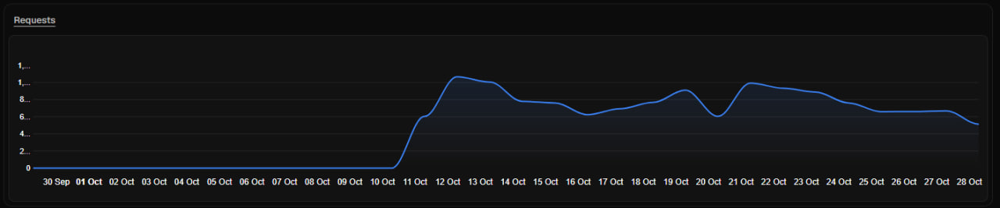
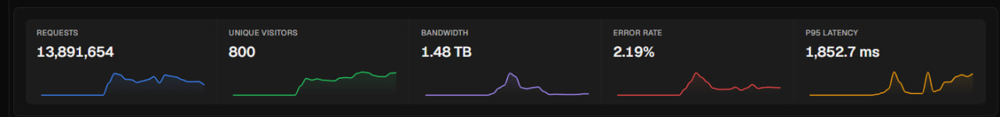
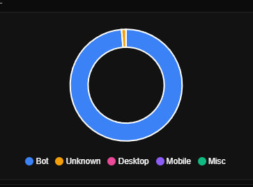
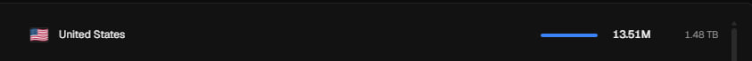
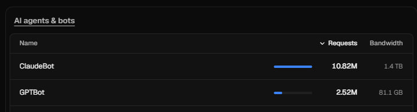
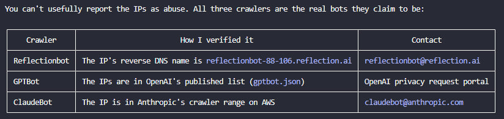

Mình tự host Gitea trên một máy chủ OCI Always Free để lưu bản sao các repo trên GitHub. Cứ nghĩ đây là góc nhỏ chỉ có mình lui tới, cho đến khi phát hiện ba "vị khách" ghé thăm đều đặn: ClaudeBot, GPTBot và Reflectionbot. Từ vài dấu hiệu bất thường trong log, mình lần ra một repo private bị công khai ngoài ý muốn, rồi tìm cách chặn crawler mà vẫn giữ các ứng dụng hoạt động bình thường. Đây là câu chuyện từ lúc phát hiện đến khi xử lý và theo dõi sau đó.

## Phát hiện

Sáng 29/10/2026, mình thấy máy chủ chạy Gitea ở Nhật bận bất thường. Mở nhật ký truy cập (access log) của Traefik, mình mới biết log xoay vòng nhanh đến mức phần còn giữ lại chỉ bao phủ khoảng 4,5 tiếng, từ 17:55 đến 22:22 UTC ngày 28/10. Chỉ trong khoảng thời gian đó đã có **86.765 request**.

| User agent | Số request |
| --- | --- |
| ClaudeBot (Anthropic) | 39.860 |
| GPTBot (OpenAI) | 26.901 |
| Reflectionbot (Reflection AI) | 16.412 |
| Bun (chính gitea-mirror của mình đang sync) | 3.587 |
| Còn lại (DuckDuckBot, OAI-SearchBot) | 5 |

Khoảng 95% phản hồi HTTP 200 đến từ các trang `src`, `commit`, `raw` của 86 repo mirror. Các crawler lần qua **từng commit của từng repo**, mà mỗi commit lại có vài trang để đọc. Cộng dồn lại, lượng truy cập tăng lên rất nhanh.

Nhìn lại số liệu cả tháng, mình thấy lưu lượng gần như bằng 0 cho đến ngày 10/10. Từ 11/10, nó tăng vọt và liên tục duy trì ở mức cao:



Tổng cộng là gần **13,9 triệu request** và **1,48 TB** băng thông, chỉ để phục vụ một Gitea vốn có mỗi mình sử dụng:



**Nếu tự host trên VPS, bạn nên để ý cả chi phí băng thông.** Lượng dữ liệu bot tải về vẫn tính vào lưu lượng của máy chủ. Tùy nhà cung cấp và gói dịch vụ, vượt hạn mức có thể khiến bạn phải trả thêm phí hoặc bị giới hạn tốc độ. Mình may mắn vì hạn mức băng thông của OCI khá rộng rãi, nên đợt này chưa phát sinh thêm chi phí. Nhưng với một VPS có hạn mức thấp hơn, 1,48 TB chỉ từ crawler có thể trở thành khoản tiền ngoài dự tính.

Gần như toàn bộ lượt truy cập là từ bot, với nguồn truy cập cũng gần như hoàn toàn ở Mỹ:





Riêng ClaudeBot đã chiếm 10,82 triệu request và 1,4 TB băng thông. GPTBot cũng đóng góp thêm 2,52 triệu request:



## Đoán nguyên nhân

Điều đầu tiên mình lo là tài khoản có bị lộ hay không. Kiểm tra lại log, mình thấy:

- Toàn bộ request đều ẩn danh, không có request nào đăng nhập.
- Không có ứng dụng bên ngoài nào gửi POST, PATCH, push hay gọi API. Mọi thao tác ghi đều đến từ chính máy chủ, do gitea-mirror đang đồng bộ.
- Cả ba crawler đều có nguồn gốc xác thực: IP của GPTBot nằm trong danh sách OpenAI công bố, ClaudeBot thuộc dải IP của Anthropic, còn Reflectionbot có DNS ngược trỏ về `reflection.ai`.



Những dấu hiệu này không cho thấy tài khoản bị xâm nhập. Các bot đang truy cập những trang mà Gitea công khai cho người dùng ẩn danh: chúng hỏi `/robots.txt` trước, nhận về 404 vì không có tệp này, rồi tiếp tục thu thập các trang trả về HTTP 200. Nhìn lại, mình đã để cửa mở mà không nhận ra; vấn đề cần xử lý trước hết nằm ở cấu hình của chính mình.

Trong lúc kiểm tra, mình phát hiện chuyện đáng lo hơn: **một repo private đã bị lộ**. Repo gốc trên GitHub là private, nhưng bản mirror trên Gitea lại **public**, và Reflectionbot đã lấy 48 trang từ đó. Lần theo quá trình đồng bộ, mình tìm được nguyên nhân ở một bản ghi cũ mà gitea-mirror vẫn dùng lại:

1. Ban đầu, tên này thuộc về một repo public. Khi nhập repo, gitea-mirror lưu cờ `is_private = 0`.
2. Sau đó, repo public được chuyển sang namespace khác.
3. Mình tạo một repo **private** mới với tên cũ. Bản ghi trong gitea-mirror vẫn trỏ đến URL ấy và giữ cờ public. Vì coi đây là cùng một repo, công cụ không kiểm tra lại quyền hiển thị.
4. Gitea tiếp tục kéo bản mirror từ URL đó bằng GitHub token. Kết quả là nội dung của repo private mới được đồng bộ vào bản mirror public trên Gitea.

Cấu hình `visibility: "private"` của gitea-mirror cũng không ngăn được tình huống này. Nó chỉ áp dụng cho các tổ chức mà công cụ tạo ra; quyền hiển thị của từng repo vẫn dựa trên cờ private lấy từ GitHub ở thời điểm nhập ban đầu.

Mình rà soát toàn bộ và tìm thấy 105 repo có thể đọc mà không cần đăng nhập, tất cả đều thuộc tài khoản cá nhân trên Gitea. Các tổ chức còn lại đều private. Trong 105 repo công khai ấy, chỉ repo vừa phát hiện có nguồn private trên GitHub.

Còn lý do Cloudflare không chặn các bot thì đơn giản hơn: mọi bản ghi DNS của ứng dụng đều là bản ghi `A` ở chế độ **DNS only** (mây xám). Bot đi thẳng đến máy chủ gốc (origin), nên các request này không hề qua Cloudflare để được lọc.

## Xử lý

**Việc đầu tiên là ngăn lộ thêm dữ liệu.** Mình dừng Gitea cùng gitea-mirror, rồi chuyển repo bị lộ về private.

Ban đầu, mình định đưa toàn bộ ứng dụng ra sau Cloudflare Tunnel và Cloudflare Access. Nhưng phương án này kéo theo khá nhiều việc: đổi địa chỉ trên Coolify sang `http://`, cấu hình lại từng ứng dụng, rồi xử lý webhook. Mình tạm để lại cho sau và chọn bước ít thay đổi hơn: **bật proxy (mây cam)** cho các bản ghi DNS. Chúng vẫn trỏ về IP cũ, Traefik và Coolify vẫn giữ nguyên cách chạy, còn Cloudflare đứng giữa để lọc bot.

Chiều 29/10, mình triển khai lần lượt như sau:

1. **Chuyển SSL/TLS từ Full sang Full (strict).** Traefik tiếp tục dùng chứng chỉ Let's Encrypt và gia hạn qua HTTP-01 khi bật proxy. Mình tránh chế độ Flexible vì Traefik đã chuyển hướng HTTP sang HTTPS; kết hợp hai bên sẽ gây vòng lặp chuyển hướng.
2. **Thử trước với một ứng dụng ít rủi ro**, là một terminal trên web. Mình kiểm tra header `server: cloudflare`, khả năng tải trang và kết nối WebSocket.
3. **Thiết lập các lớp chặn bot** có sẵn trên gói Free:
   - **AI bot policies**: đặt Training, Agent và Search thành Block, vì mình không cần các ứng dụng này xuất hiện trong kết quả tìm kiếm của AI.
   - **Bot Preference Sync** (`robots.txt` do Cloudflare quản lý): tự chèn các dòng `Disallow` dành cho bot AI vào `robots.txt`, hoặc phục vụ tệp này nếu ứng dụng chưa có.
   - **Một quy tắc WAF tùy chỉnh** để chặn thêm những trường hợp chính sách trên có thể bỏ sót:

     ```text
     (cf.verified_bot_category in {"AI Crawler" "AI Assistant" "AI Search"})
     or (http.user_agent contains "Reflectionbot")
     ```

4. **Bật proxy cho bản ghi wildcard** `*.miti99.dev`. Một lần chuyển là áp dụng cho gần 20 ứng dụng; các ứng dụng mới dùng bản ghi wildcard này cũng được proxy mặc định. Nếu cần quay lại cấu hình cũ, mình chỉ việc tắt proxy.
5. **Bật proxy cho Coolify sau cùng**, rồi kiểm tra webhook triển khai khi push lên GitHub, số liệu Sentinel gửi từ máy chủ thứ hai, MCP và kết nối WebSocket thời gian thực.
6. **Cấu hình Traefik tin cậy dải IP của Cloudflare** qua `forwardedHeaders.trustedIPs`, để ứng dụng nhận được IP thật của người dùng thay vì chỉ thấy IP của Cloudflare.

Mình cũng chủ động **không bật Bot Fight Mode**. Trên gói Free, cơ chế thử thách của tính năng này có thể cản các ứng dụng truy cập tự động, trong khi quy tắc WAF không cho phép tạo ngoại lệ để bỏ qua nó. Với hệ thống của mình, bật lên có nguy cơ làm gián đoạn webhook GitHub, Sentinel, MCP, đồng bộ Nextcloud và cả Git.

Kiểm tra bằng `curl`, request mang user agent của trình duyệt nhận HTTP 200, còn request mang user agent GPTBot, ClaudeBot hoặc Reflectionbot nhận HTTP 403 ngay tại Cloudflare. Sau bước này, mình bật lại Gitea phía sau proxy.

Dù vậy, đưa lưu lượng qua Cloudflare vẫn có những giới hạn cần lưu ý:

- Phần thân request vượt 100 MB sẽ bị từ chối. Nextcloud tải lên theo từng phần nhỏ nên không vướng giới hạn này.
- Request chờ phản hồi quá lâu, khoảng 100 giây, có thể gặp lỗi 524. Các lời gọi LLM kéo dài mà không truyền kết quả dần là trường hợp cần chú ý.
- **IP máy chủ gốc vẫn truy cập được.** Bot đã biết IP có thể gọi thẳng vào Traefik. Proxy giúp lọc crawler đi qua Cloudflare, nhưng chưa thay thế được việc kiểm soát quyền truy cập.

## Theo dõi

Log sau khi chuyển đổi cho thấy rõ giới hạn cuối cùng này. Mình bật proxy cho Gitea lúc 09:14 UTC, tức 16:14 giờ Việt Nam, rồi lọc access log trên máy chủ gốc để xem ba bot còn truy cập hay không:

```bash
for ua in GPTBot ClaudeBot Reflectionbot; do
  echo "$ua $(grep -c "$ua" access.log)"
done
```

- **ClaudeBot** dừng hẳn lúc 09:14:20, gần như ngay sau khi đổi bản ghi DNS.
- **Reflectionbot** tiếp tục truy cập rải rác khoảng 6 phút, có thể do bộ nhớ đệm DNS.
- **GPTBot** vẫn gửi thẳng đến IP máy chủ gốc thêm **7.056 request trong một tiếng**, đến 10:14 mới dừng. Trường `ClientAddr` ghi nhận IP của OpenAI thay vì Cloudflare. Mình nghi bot giữ kết quả DNS trong bộ nhớ đệm lâu hơn TTL.
- Từ thời điểm đó đến lúc viết bài, khoảng 4 tiếng, máy chủ gốc ghi nhận **0 request** từ cả ba bot.

Để biết cấu hình này có tiếp tục hiệu quả hay không, mình sẽ theo dõi thêm:

- **Security → Events** trên Cloudflare: kiểm tra bot AI có tiếp tục bị chặn và có user agent lạ nào cần bổ sung vào quy tắc WAF hay không.
- **Access log của Traefik trên máy chủ gốc**: lọc theo cách trên. Nếu crawler xuất hiện trở lại với `ClientAddr` nằm ngoài dải IP Cloudflare, nó đang truy cập trực tiếp. Khi đó, mình sẽ cân nhắc tường lửa chỉ cho phép Cloudflare kết nối vào, hoặc quay lại phương án tunnel.
- **`robots.txt` của từng host**: dùng `curl https://<app>.example.com/robots.txt` để kiểm tra các dòng `Disallow` dành cho bot AI mà Cloudflare thêm vào.
- **Ứng dụng mới**: Coolify tạo bản ghi DNS ở chế độ DNS only. Host có bản ghi riêng cần được bật proxy thủ công; nếu bỏ sót, bot lại có đường truy cập trực tiếp.
- **Dải IP của Cloudflare**: dù ít thay đổi, mình vẫn cần cập nhật `trustedIPs` của Traefik khi có thay đổi.

Mình vẫn còn một số việc phải làm: bật `REQUIRE_SIGNIN_VIEW` để yêu cầu đăng nhập trước khi xem các trang Gitea, dọn bỏ toàn bộ mirror và thay GitHub token của gitea-mirror. Trong đó, yêu cầu đăng nhập mới trực tiếp giải quyết việc người ngoài đọc được repo; proxy chỉ là lớp bảo vệ bổ sung. Mình cũng đang cân nhắc gửi yêu cầu xóa dữ liệu đã thu thập tới Reflection AI, OpenAI và Anthropic.

## Bài học

- **Đã công khai thì phải tính đến chuyện bị thu thập dữ liệu rất kỹ.** Bot AI có thể lần qua từng commit, chứ không dừng ở trang chủ.
- **Cần kiểm tra lại quyền hiển thị khi đồng bộ giữa các hệ thống.** Một bản ghi cũ trùng tên đã đủ khiến nội dung repo private xuất hiện trong bản mirror public.
- **Muốn Cloudflare lọc lưu lượng thì phải đưa lưu lượng qua proxy.** Với hệ thống tự host nhỏ của mình, đây là bước đầu phù hợp để chặn crawler, trước khi cân nhắc tunnel.
- **Cần xem lại các kết nối tự động trước khi bật Bot Fight Mode.** Máy chủ còn nhận webhook và phục vụ các ứng dụng ngoài trình duyệt, nên chặn bot cũng phải tính đến những luồng truy cập này.
